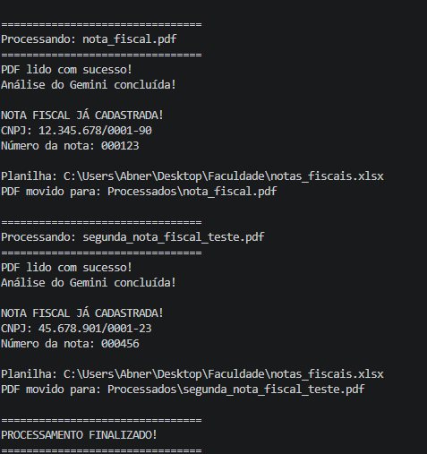

# 📄 Automação de Notas Fiscais com Python e Gemini AI

Projeto desenvolvido em Python para automatizar a leitura, extração e
organização de informações de notas fiscais em PDF utilizando
inteligência artificial.

## 🎯 Objetivo

Reduzir o trabalho manual na leitura de notas fiscais, utilizando a API
do Gemini para identificar informações importantes e armazená-las
automaticamente em uma planilha Excel.

## ⚙️ Funcionalidades

-   Leitura automática de arquivos PDF.
-   Extração de texto utilizando PyMuPDF.
-   Análise de documentos com inteligência artificial (Gemini AI).
-   Identificação de informações da nota fiscal.
-   Armazenamento dos dados em planilha Excel.
-   Verificação de notas duplicadas por CNPJ e número da nota.
-   Processamento de múltiplos arquivos PDF.
-   Movimentação dos documentos processados para uma pasta específica.
-   Prevenção de sobrescrita de arquivos com nomes iguais.

## 🖥️ Demonstração do projeto

### Execução da automação



## 🛠️ Tecnologias utilizadas

-   Python
-   Gemini API
-   PyMuPDF
-   Requests
-   OpenPyXL
-   Python Dotenv
-   Git e GitHub

## 📋 Informações extraídas

-   Fornecedor
-   CNPJ
-   Número da nota fiscal
-   Data de emissão
-   Data de vencimento
-   Cliente
-   Produtos ou serviços
-   Subtotal
-   Impostos
-   Valor total

## 📁 Estrutura do projeto

``` text
automacao-notas-fiscais/
├── Documentos/
├── Processados/
├── main.py
├── .env
├── .gitignore
└── notas_fiscais.xlsx
```

As pastas e arquivos de dados são utilizados durante a execução.
Documentos fiscais, planilhas com dados reais e credenciais não devem
ser publicados no repositório.

## 🚀 Como executar o projeto

### 1. Clonar o repositório

``` bash
git clone https://github.com/Arbizada/automacao-notas-fiscais.git
```

### 2. Entrar na pasta

``` bash
cd automacao-notas-fiscais
```

### 3. Criar um ambiente virtual

``` bash
python -m venv venv
```

### 4. Ativar o ambiente virtual no Windows

``` powershell
.\venv\Scripts\Activate.ps1
```

### 5. Instalar as dependências

``` bash
pip install pymupdf requests python-dotenv openpyxl
```

### 6. Configurar a chave da API

Crie um arquivo `.env` na raiz do projeto:

``` env
GEMINI_API_KEY=sua_chave_aqui
```

Substitua `sua_chave_aqui` pela sua chave da API do Gemini. Não
compartilhe esse arquivo.

### 7. Executar a automação

Coloque os PDFs na pasta `Documentos` e execute:

``` bash
python main.py
```

Os dados extraídos serão armazenados em `notas_fiscais.xlsx`, e os PDFs
concluídos serão movidos para `Processados`.

## 🔐 Segurança

-   Mantenha a chave da API no arquivo `.env`.
-   Não publique documentos fiscais reais.
-   Não publique planilhas que contenham dados confidenciais.
-   Confira o `.gitignore` antes de enviar alterações ao GitHub.

## 📚 Aprendizados e conhecimentos aplicados

-   Lógica de programação.
-   Manipulação de arquivos.
-   Integração com APIs.
-   Automação de processos.
-   Tratamento de exceções.
-   Manipulação de planilhas.
-   Estruturação de dados JSON.
-   Controle de versão com Git.

## 👨‍💻 Autor

**Abner Moura**

Estudante de Engenharia de Software, interessado em desenvolvimento de
software, inteligência artificial e automação de processos.

GitHub: https://github.com/Arbizada
